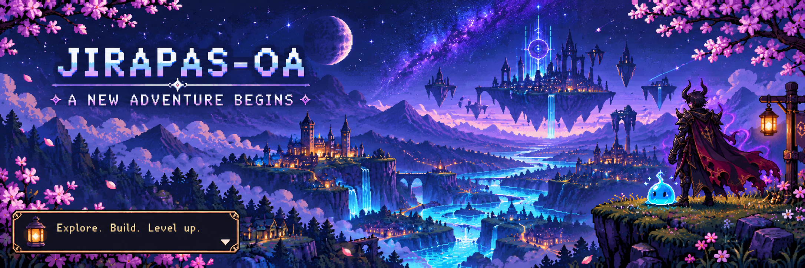
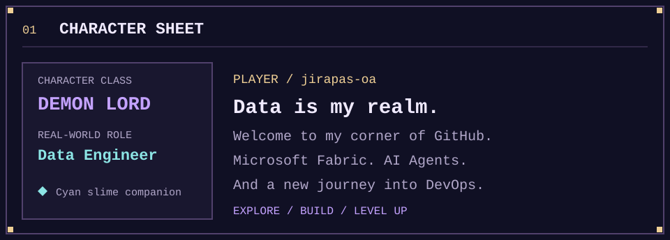
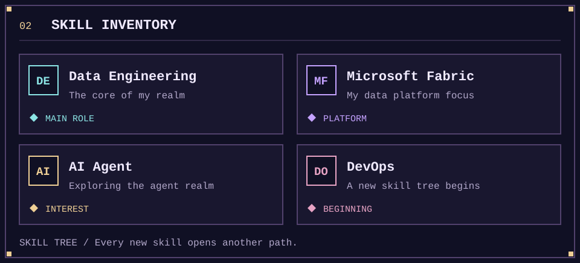
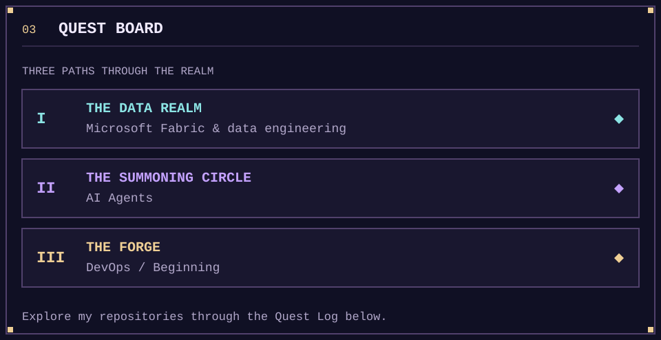
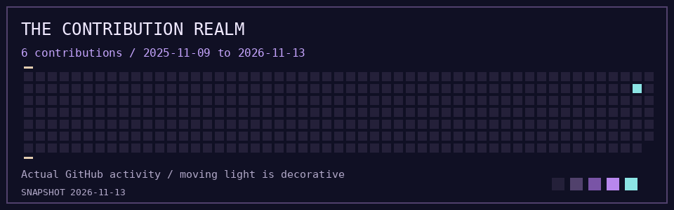
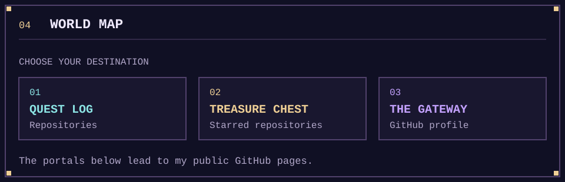
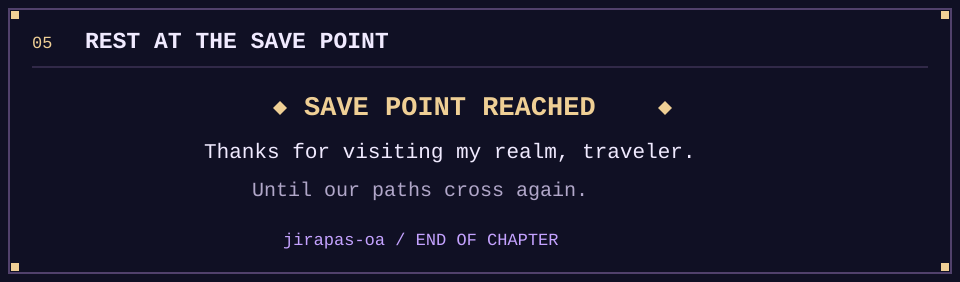

  

<h1 align="center">The Data Realm of jirapas-oa</h1>

  
   <samp>✦ THE DEMON LORD HAS ENTERED THE REALM ✦</samp>

  <strong>Data Engineer · Microsoft Fabric · AI Agent</strong> 
  DevOps: Beginning a new skill tree.

  <a href="#character">Character</a> &nbsp; ✦ &nbsp;
  <a href="#skills">Skills</a> &nbsp; ✦ &nbsp;
  <a href="#quests">Quests</a> &nbsp; ✦ &nbsp;
  <a href="#activity">Activity</a> &nbsp; ✦ &nbsp;
  <a href="#portals">Portals</a>

## 🜲 Character sheet

## ✦ Skill inventory

## ⚔ Quest board

  <a href="https://github.com/jirapas-oa?tab=repositories"><strong>⚔ Open the Quest Log →</strong></a>

## ✧ Realm activity

<samp>EVERY CONTRIBUTION WRITES ANOTHER CHAPTER</samp>

31-day chart refreshes via GitHub Readme Activity Graph. The contribution map is a dated snapshot; its moving light is decorative.

## ◈ World map

  <a href="https://github.com/jirapas-oa?tab=repositories">⚔ Quest Log</a>
  &nbsp; · &nbsp;
  <a href="https://github.com/jirapas-oa?tab=stars">✦ Treasure Chest</a>
  &nbsp; · &nbsp;
  <a href="https://github.com/jirapas-oa">◈ The Gateway</a>

 

Pixel RPG × Anime · Explore. Build. Level up.

